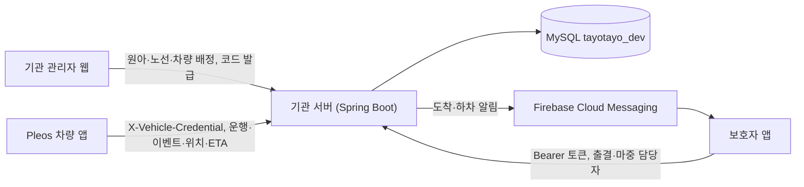
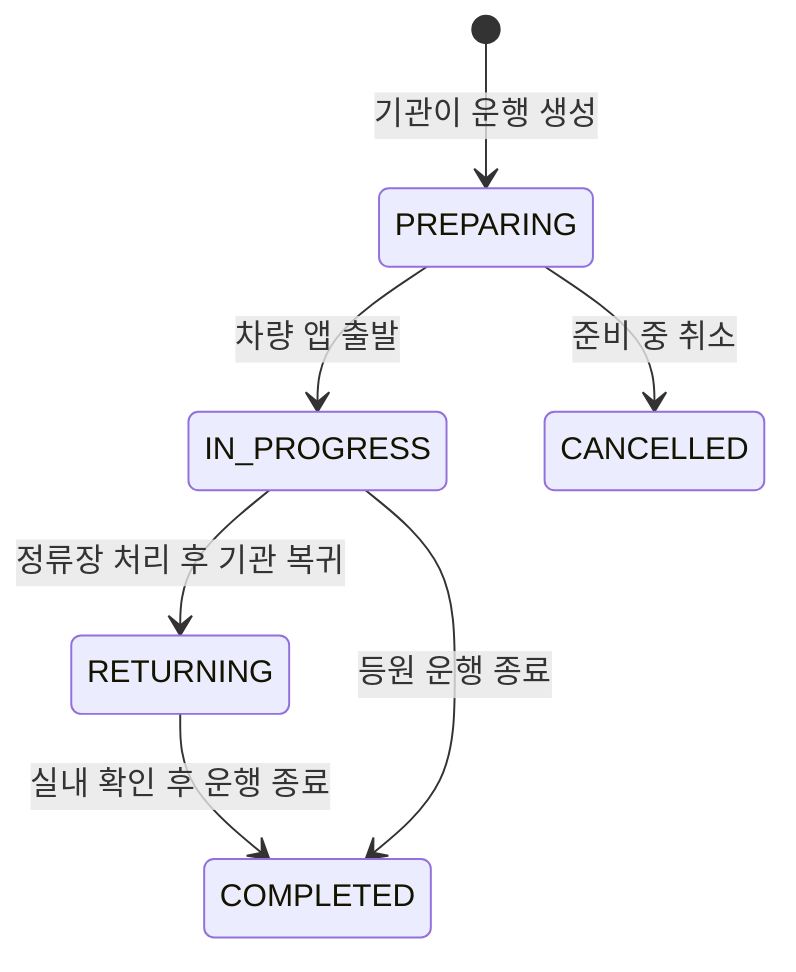

# 타요타요 기관 서버

**통학 차량 한 번의 운행을 기관·차량·보호자가 같은 기록으로 보도록 저장하고 전달하는 API 서버입니다.**
Pleos 차량 앱이 보낸 탑승·도착·인계·하차 기록을 저장하고, 보호자 앱과 기관 관리자 웹이 그 기록을 조회합니다. 도착과 하차 때는 해당 보호자에게 FCM 알림을 보냅니다.

| 구성 | 저장소 / 위치 |
| --- | --- |
| 서버 · API | 이 저장소 [`backend/`](backend) |
| 기관 관리자 웹 | [TayoTayo-web](https://github.com/Hyundai-Mobility-Challenge/TayoTayo-web) · 이 저장소의 [`web/`](web) 서브모듈 |
| Pleos 차량 앱 (대표 저장소) | [TayoTayo-vehicle](https://github.com/Hyundai-Mobility-Challenge/TayoTayo-vehicle) |
| 보호자 앱 | [TayoTayo-parent](https://github.com/Hyundai-Mobility-Challenge/TayoTayo-parent) |

## 서버가 맡는 일



| 영역 | 서버가 하는 일 |
| --- | --- |
| 기관 운영 | 기관·직원·차량·정류장·노선을 관리하고, 원아를 노선·차량·정류장·요일에 배정합니다. |
| 연결 | 차량 페어링 코드(10분)와 보호자 초대 코드(7일)를 발급합니다. 차량 credential은 SHA-256 값만 저장합니다. |
| 운행 기록 | 날짜·노선으로 운행을 만들 때 그날의 정류장 순서와 원아 명단을 복사해 둡니다. 이후 배정이 바뀌어도 지난 운행 기록은 그대로 남습니다. |
| 위치·예상 시간 | 차량 앱이 보낸 위치와 내비 ETA를 출처·시각과 함께 저장합니다. 서버가 경로를 계산하거나 도착·하차를 판정하지는 않습니다. |
| 보호자 | 연결된 아이 범위에서만 운행 진행, 출결 요청, 지정 인계자, 공유 링크, 알림을 처리합니다. |
| 알림 | 알림을 DB에 먼저 기록하고 중복을 막은 뒤, Firebase 설정이 있으면 FCM으로 보냅니다. |

### 운행 상태



정류장은 `PENDING → ARRIVED → COMPLETED`(또는 `SKIPPED`) 순서로 바뀝니다. 상태 순서에 맞지 않는 요청은 `409 Conflict`로 거절하고, 완료되지 않은 정류장이 남아 있으면 운행을 종료하지 않습니다.

## 빠르게 실행하기

### 준비물

- Java 21, MySQL 8, Node.js 20 이상(관리자 웹)
- 실행 스크립트는 Windows 기준입니다. MySQL은 서버와 같은 PC에서 실행하는 구성을 기본으로 합니다.

```sh
git clone --recurse-submodules https://github.com/Hyundai-Mobility-Challenge/TayoTayo-server.git
```

이미 받았다면 `git submodule update --init --recursive`로 `web/`을 초기화합니다. 서브모듈은 웹 저장소의 고정 커밋을 가리키므로, 웹 변경을 반영하려면 이 저장소의 서브모듈 참조도 갱신해야 합니다.

### 1. 데이터베이스 만들기

새 개발 DB를 만들 때만 [실행용 SQL](TayoTayo_실행용_회의반영.sql)을 MySQL Workbench에서 열어 전체 실행합니다. `tayotayo_dev` 데이터베이스와 테이블, 햇살 유치원 데모 데이터가 함께 만들어집니다.

> [!WARNING]
> 전체 초기화 파일입니다. 이미 테이블이나 데이터가 있는 DB에는 실행하지 마세요. 기존 DB를 고치는 migration 파일이 아닙니다.

### 2. 서버 실행

1. `backend\start-server.bat`을 실행합니다.
2. 처음 실행하면 MySQL 주소·포트·DB 이름·계정·비밀번호를 묻습니다. 같은 PC의 기본값은 `127.0.0.1`, `3306`, `tayotayo_dev`, `ssafy`이며, 입력값은 `backend\.secrets\server.properties`에 저장됩니다(Git 제외).
3. 시작이 끝나면 [http://localhost:8080/health](http://localhost:8080/health)로 확인합니다. API 문서는 [http://localhost:8080/swagger-ui.html](http://localhost:8080/swagger-ui.html)입니다.
4. 종료는 실행 창에서 `Ctrl+C`입니다.

| 접속하는 곳 | 서버 주소 |
| --- | --- |
| 서버 PC 브라우저 | `http://127.0.0.1:8080` |
| 같은 PC의 Android 에뮬레이터 | `http://10.0.2.2:8080` |
| 같은 Wi-Fi의 휴대폰·다른 PC | `http://<서버 PC의 LAN IPv4>:8080` (필요하면 Windows 방화벽에서 8080 허용) |

앱에는 호스트와 포트만 입력합니다. `/api/v1`은 앱이 붙입니다.

### 3. 데모 데이터로 시연하기

| 항목 | 데모 값 |
| --- | --- |
| 관리자 계정 | `orgs@example.com` / `orgspass123` (기관 ID `1`) |
| 데이터 | 차량 ID `1`, 원아 ID `1`~`3`, 오늘 날짜의 오전 등원 운행 1건(`PREPARING`) |
| 차량용 API 점검 credential | `DEMO-HASAL-VEHICLE-1` |

시연용 비밀번호와 credential은 외부 공개나 운영 환경에 사용하지 마세요.

1. [TayoTayo-web README](https://github.com/Hyundai-Mobility-Challenge/TayoTayo-web)대로 관리자 웹을 실행하고 데모 계정으로 로그인합니다.
2. **원아 명단**에서 원아의 **보호자 초대**를 눌러 초대 코드를 발급하고, 보호자 앱의 아이 연결 화면에 입력합니다. 보호자 계정은 앱에서 먼저 만듭니다.
3. **차량 관리**에서 햇살 1호차의 **코드 발급**을 눌러 차량 페어링 코드를 받고, 차량 앱의 차량 연결 화면에 입력합니다.
4. 운행은 SQL이 오늘 날짜로 하나 만들어 둡니다. 날짜나 배정을 바꿔 새 운행이 필요하면 **운행 관리**에서 해당 날짜에 유효한 원아 배정을 확인한 뒤 노선으로 운행을 만듭니다.

개발용 이메일 인증 코드는 실제로 발송되지 않고 웹 가입 화면에 표시됩니다.

## 설정

| 설정 | 역할 | 기본값·주의 |
| --- | --- | --- |
| `DB_URL` | JDBC 주소 | `jdbc:mysql://127.0.0.1:3306/tayotayo_dev?...` |
| `DB_USERNAME`, `DB_PASSWORD` | MySQL 로그인 | 첫 실행 때 입력해 로컬 파일에 저장 |
| `FIREBASE_ENABLED` | FCM 전송 사용 | 기본 `false` |
| `FIREBASE_CREDENTIALS_PATH` | Firebase Admin 서비스 계정 JSON 경로 | 저장소 밖의 키 파일 |
| `FIREBASE_PROJECT_ID` | Firebase 프로젝트 ID | 서비스 계정의 `project_id`와 같아야 함 |
| `FIREBASE_TEST_ENDPOINT_ENABLED` | 개발용 FCM 드라이런 API | 기본 `false`, 확인 후 끄기 |

Kakao 지도 검색은 서버가 아니라 관리자 웹이 중계합니다. 서비스 계정 JSON, 실제 토큰, 비밀번호는 Git에 넣지 않습니다.

## 기술 스택과 구조

- **Java 21 · Spring Boot 4.1.2 · Spring MVC**: 컨트롤러가 요청을 받고 `JdbcTemplate`으로 MySQL을 읽고 씁니다.
- **MySQL 8**: 스키마는 서버가 만들거나 바꾸지 않고 실행용 SQL로 준비합니다.
- **Firebase Admin SDK**: 도착·하차 알림을 FCM으로 보냅니다.
- **springdoc-openapi**: `/swagger-ui.html`에서 API를 시험합니다.

```text
TayoTayo-server/
├─ backend/                      Spring Boot API (start-server.bat, run-server.ps1)
│  └─ src/main/java/com/tayotayo/backend/
│     ├─ auth · orgs · management · vehicles · children · invitations
│     ├─ trips · operations · telemetry
│     └─ guardian · attendance · pickups · sharing · announcements · notifications
├─ web/                          관리자 웹 서브모듈
├─ docs/                         Swagger·DB·상세 안내
├─ TayoTayo_실행용_회의반영.sql   스키마 + 데모 데이터
└─ TayoTayo_OpenAPI_3.0.json     API 정의
```

패키지별 역할, 계정·운행·보호자 데이터 흐름, 테이블 묶음, 관리자 운영 순서는 [서버 구조와 상세 사용 방법](docs/SERVER_GUIDE.md)에 정리했습니다.

## 현재 범위와 유의점

- 인증 코드 응답의 `debugCode`는 메일 서버가 없는 개발 설정입니다. 운영 인증 수단으로 쓰지 마세요.
- access token은 개발용 메모리 저장소에 있어 서버를 재시작하면 만료됩니다. refresh token은 해시해 DB에 저장합니다. 비밀번호는 salt를 넣은 PBKDF2-HMAC-SHA256(120,000회)로 저장합니다.
- 공개 운영 전에는 인증, 비밀값, HTTPS, 권한 정책을 따로 점검해야 합니다.
- 데이터가 있는 DB는 실행용 SQL을 다시 돌려 올리지 말고, 백업 후 별도 migration으로 바꿉니다.

## 문서

- [서버 구조와 상세 사용 방법](docs/SERVER_GUIDE.md)
- [Swagger / OpenAPI 사용 안내](docs/SWAGGER.md)
- [데이터베이스 안내](docs/DATABASE.md)
