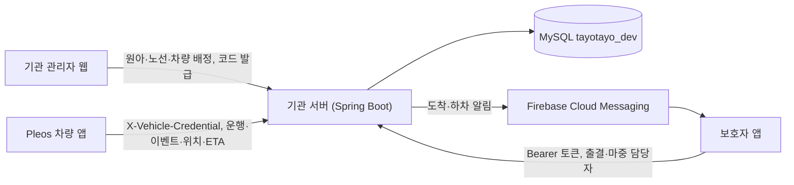
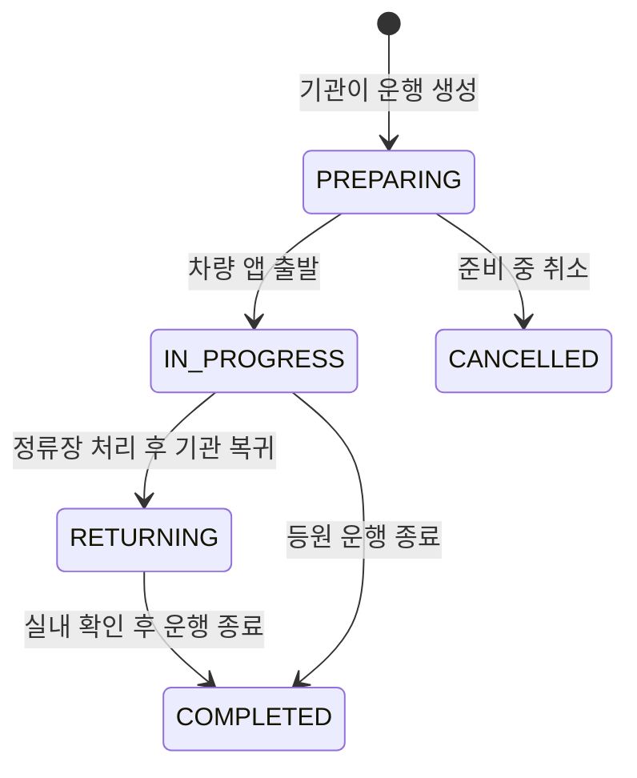

# 타요타요 기관 서버

**통학 차량 한 번의 운행을 기관·차량·보호자가 같은 기록으로 보도록 저장하고 전달하는 API 서버입니다.**
Pleos 차량 앱이 보낸 탑승·도착·인계·하차 기록을 저장하고, 보호자 앱과 기관 관리자 웹이 그 기록을 조회합니다. 도착과 하차 때는 해당 보호자에게 FCM 알림을 보냅니다.

| 구성 | 저장소 / 위치 |
| --- | --- |
| 서버 · API | 이 저장소 [`backend/`](backend) |
| 기관 관리자 웹 | [TayoTayo-web](https://github.com/Hyundai-Mobility-Challenge/TayoTayo-web) · 이 저장소의 [`web/`](web) 서브모듈 |
| Pleos 차량 앱 (대표 저장소) | [TayoTayo-vehicle](https://github.com/Hyundai-Mobility-Challenge/TayoTayo-vehicle) |
| 보호자 앱 | [TayoTayo-parent](https://github.com/Hyundai-Mobility-Challenge/TayoTayo-parent) |

## 서버가 맡는 일



| 영역 | 서버가 하는 일 |
| --- | --- |
| 기관 운영 | 기관·직원·차량·정류장·노선을 관리하고, 원아를 노선·차량·정류장·요일에 배정합니다. |
| 연결 | 차량 페어링 코드(10분)와 보호자 초대 코드(7일)를 발급합니다. 차량 credential은 SHA-256 값만 저장합니다. |
| 운행 기록 | 날짜·노선으로 운행을 만들 때 그날의 정류장 순서와 원아 명단을 복사해 둡니다. 이후 배정이 바뀌어도 지난 운행 기록은 그대로 남습니다. |
| 위치·예상 시간 | 차량 앱이 보낸 위치와 내비 ETA를 출처·시각과 함께 저장합니다. 서버가 경로를 계산하거나 도착·하차를 판정하지는 않습니다. |
| 보호자 | 연결된 아이 범위에서만 운행 진행, 출결 요청, 지정 인계자, 공유 링크, 알림을 처리합니다. |
| 알림 | 알림을 DB에 먼저 기록하고 중복을 막은 뒤, Firebase 설정이 있으면 FCM으로 보냅니다. |

### 운행 상태



정류장은 `PENDING → ARRIVED → COMPLETED`(또는 `SKIPPED`) 순서로 바뀝니다. 상태 순서에 맞지 않는 요청은 `409 Conflict`로 거절하고, 완료되지 않은 정류장이 남아 있으면 운행을 종료하지 않습니다.

## 시작하기

차량 앱과 보호자 앱에 입력할 서버 주소는 `https://api-demo-e677ea0e.up.railway.app`입니다. 주소 끝에 `/api/v1`이나 `/swagger-ui.html`을 붙이지 마세요. 서버와 MySQL은 이미 실행 중이며, [DB 연결 상태](https://api-demo-e677ea0e.up.railway.app/health/database)에서 `UP`을 확인할 수 있습니다.

**준비물**은 Pleos Connect 에뮬레이터의 [차량 APK](https://github.com/Hyundai-Mobility-Challenge/TayoTayo-vehicle/releases/download/v1.0.0/TayoTayo-1.0.0.apk), Android 기기의 HTTPS 연결용 보호자 앱, 별도로 전달받은 관리자·보호자 비밀번호입니다. 보호자 앱 `v0.2-invitations`에는 서버 주소 입력 메뉴가 없습니다. HTTPS 지원 릴리스가 올라오기 전에는 팀이 전달한 HTTPS 지원 APK 또는 보호자 저장소의 디버그 빌드를 사용하세요. [보호자 릴리스](https://github.com/Hyundai-Mobility-Challenge/TayoTayo-parent/releases) · [디버그 빌드 방법](https://github.com/Hyundai-Mobility-Challenge/TayoTayo-parent#시작하기)

### 관리자 로그인과 차량 페어링

1. PC에서 [시연 서버 Swagger](https://api-demo-e677ea0e.up.railway.app/swagger-ui.html)를 엽니다. 각 API는 펼친 뒤 **Try it out**으로 값을 편집하고 **Execute**로 실행합니다.
2. `POST /auth/login`에 아래 JSON을 넣고 비밀번호 자리를 전달받은 **기관 관리자 비밀번호**로 바꿉니다. 응답의 `accessToken` 값만 복사해 화면 상단 **Authorize → BearerAuth → Authorize**에 입력하고 **Close**를 누릅니다.

   ```json
   {"email":"orgs@example.com","password":"전달받은 관리자 비밀번호","clientType":"ADMIN_WEB"}
   ```

3. `POST /orgs/{orgId}/vehicles/{vehicleId}/pairing-codes`에서 `orgId`와 `vehicleId`에 각각 `1`, 요청 본문에 `{"expiresIn":600}`을 넣습니다. 응답의 6자리 `code`를 앞자리 0까지 그대로 사용합니다. 10분이 지나면 새 코드를 발급하세요.
4. 차량 앱의 **기관 · 차량 연결** 화면에 위 HTTPS 주소와 코드를 넣고 **차량 연결**을 누릅니다. **연결 완료를 확인한 다음** 아래 운행을 생성하세요. 운행은 생성 시점에 가장 최근에 페어링된 기기에 배정됩니다.

### 차량 연결 후 오늘 운행 만들기

1. PC의 PowerShell에서 아래 명령을 한 번 실행합니다. 한국 기준 오늘 날짜와 새 운행 식별자가 들어간 요청 본문이 출력됩니다.

   ```powershell
   @{
       clientTripId = [guid]::NewGuid().ToString()
       vehicleId    = "1"
       routeId      = "1"
       serviceDate  = [DateTimeOffset]::UtcNow.ToOffset([TimeSpan]::FromHours(9)).ToString('yyyy-MM-dd')
       direction    = "PICK_UP"
   } | ConvertTo-Json
   ```

2. 같은 Swagger에서 `POST /orgs/{orgId}/trips`를 엽니다. `orgId`에 `1`을 넣고 **기본 요청 예시 전체를 방금 출력한 JSON으로 교체**한 뒤 한 번 실행합니다. 응답에서 운행 번호 `id`, `status=PREPARING`, 정류장(`stops`) 3곳, 원아(`children`) 3명을 확인합니다.
3. 차량 앱의 **기관 연결 → 등원 → 배정 명단으로 운행 준비**를 누릅니다. 선택 목록이 뜨면 방금 만든 운행 번호의 **이 운행 준비**를 누릅니다. 명단이 비면 차량을 연결한 뒤 운행을 만들었는지, 날짜가 한국 기준 오늘이고 방향이 `PICK_UP`인지 확인하세요.

### 두 앱에서 등원 확인하기

1. 보호자 앱 로그인 화면에서 같은 HTTPS 주소를 설정하고 `pickup-judge@example.com`과 전달받은 **보호자 비밀번호**로 로그인합니다. 김하늘이 이미 연결돼 있어 가입과 어린이 초대 코드 입력은 생략합니다.
2. 차량에서 **준비 마침 · 순서 확인** 후 운행을 시작합니다. 성남시 **판교역 김하늘 → 야탑역 김바다 → 성남시청 이마음** 순서입니다. Pleos Virtual Console에서 정류장마다 기어 P·차속 0으로 정차한 뒤 도착을 확인합니다. 아이를 넘겨준 사람 유형을 고르고 **인계받음 → 탑승 → 벨트 확인**을 기록합니다.
3. 마지막 정류장을 마치면 **기관 도착 확인** 후 탑승한 아이마다 **기관 인계 확인 · 하차 기록**을 누릅니다. 실내를 직접 확인하고 **운행 종료**를 누릅니다.
4. 보호자 앱을 새로고침해 김하늘의 탑승·하차 기록을 확인합니다. 휴대폰 푸시는 이 시연 서버에서 꺼져 있습니다. 관리자 Swagger에서도 `GET /trips/{tripId}`에 위 운행 번호를 넣어 `status=COMPLETED`와 세 아이의 `status=DROPPED_OFF`를 확인할 수 있습니다.

[시연 서버 배포 설정](deploy/README.md)

## 설정

<details>
<summary>개발용 서버를 PC에서 실행하는 방법</summary>

Windows PC에 Java 21과 MySQL 8을 준비합니다. MySQL 서비스와 데이터베이스를 만들 수 있는 계정이 필요합니다. 첫 Gradle 빌드에는 인터넷 연결이 필요합니다.

GitHub에서 **Code → Download ZIP**을 눌러 압축을 풀거나 아래 명령으로 서버를 받습니다. 로컬 API는 서버에 포함된 Swagger UI에서 확인할 수 있습니다.

```sh
git clone https://github.com/Hyundai-Mobility-Challenge/TayoTayo-server.git
```

관리자 웹도 실행할 팀원은 웹 저장소 접근 권한과 Node.js 20 이상을 준비한 뒤 `git submodule update --init --recursive`로 `web/`을 받습니다.

새 개발 DB를 만들 때만 [실행용 SQL](TayoTayo_실행용_회의반영.sql)을 MySQL Workbench에서 열어 전체 실행합니다. `tayotayo_dev` 데이터베이스와 테이블, 햇살 유치원 데모 데이터가 함께 만들어집니다.

> [!WARNING]
> 전체 초기화 파일입니다. 이미 테이블이나 데이터가 있는 DB에는 실행하지 마세요. 기존 DB를 고치는 migration 파일이 아닙니다.

1. `backend\start-server.bat`을 실행합니다.
2. 처음 실행하면 MySQL 주소·포트·DB 이름·계정·비밀번호를 묻습니다. 같은 PC의 기본값은 `127.0.0.1`, `3306`, `tayotayo_dev`, `ssafy`이며, 입력값은 `backend\.secrets\server.properties`에 저장됩니다(Git 제외).
3. 시작이 끝나면 [http://localhost:8080/health](http://localhost:8080/health)와 [DB 연결 상태](http://localhost:8080/health/database)를 차례로 확인합니다. API 문서는 [http://localhost:8080/swagger-ui.html](http://localhost:8080/swagger-ui.html)입니다.
4. 종료는 실행 창에서 `Ctrl+C`입니다.

| 접속하는 곳 | 서버 주소 |
| --- | --- |
| 서버 PC 브라우저 | `http://127.0.0.1:8080` |
| 같은 PC의 Android 에뮬레이터 | `http://10.0.2.2:8080` |
| 같은 Wi-Fi의 휴대폰·다른 PC | `http://<서버 PC의 LAN IPv4>:8080` (필요하면 Windows 방화벽에서 8080 허용) |

앱에는 호스트와 포트만 입력합니다. `/api/v1`은 앱이 붙입니다.

</details>

| 설정 | 역할 | 기본값·주의 |
| --- | --- | --- |
| `DB_URL` | JDBC 주소 | `jdbc:mysql://127.0.0.1:3306/tayotayo_dev?...` |
| `DB_USERNAME`, `DB_PASSWORD` | MySQL 로그인 | 첫 실행 때 입력해 로컬 파일에 저장 |
| `FIREBASE_ENABLED` | FCM 전송 사용 | 기본 `false` |
| `FIREBASE_CREDENTIALS_PATH` | Firebase Admin 서비스 계정 JSON 경로 | 저장소 밖의 키 파일 |
| `FIREBASE_PROJECT_ID` | Firebase 프로젝트 ID | 서비스 계정의 `project_id`와 같아야 함 |
| `FIREBASE_TEST_ENDPOINT_ENABLED` | 개발용 FCM 드라이런 API | 기본 `false`, 확인 후 끄기 |

Kakao 지도 검색은 서버가 아니라 관리자 웹이 중계합니다. 서비스 계정 JSON, 실제 토큰, 비밀번호는 Git에 넣지 않습니다.

## 기술 스택과 구조

- **Java 21 · Spring Boot 4.1.2 · Spring MVC**: 컨트롤러가 요청을 받고 `JdbcTemplate`으로 MySQL을 읽고 씁니다.
- **MySQL 8**: 스키마는 서버가 만들거나 바꾸지 않고 실행용 SQL로 준비합니다.
- **Firebase Admin SDK**: 도착·하차 알림을 FCM으로 보냅니다.
- **springdoc-openapi**: `/swagger-ui.html`에서 API를 시험합니다.

```text
TayoTayo-server/
├─ backend/                      Spring Boot API (start-server.bat, run-server.ps1)
│  └─ src/main/java/com/tayotayo/backend/
│     ├─ auth · orgs · management · vehicles · children · invitations
│     ├─ trips · operations · telemetry
│     └─ guardian · attendance · pickups · sharing · announcements · notifications
├─ web/                          관리자 웹 서브모듈
├─ docs/                         Swagger·DB·상세 안내
├─ TayoTayo_실행용_회의반영.sql   스키마 + 데모 데이터
└─ TayoTayo_OpenAPI_3.0.json     API 정의
```

패키지별 역할, 계정·운행·보호자 데이터 흐름, 테이블 묶음, 관리자 운영 순서는 [서버 구조와 상세 사용 방법](docs/SERVER_GUIDE.md)에 정리했습니다.

## 현재 범위와 유의점

- 인증 코드 응답의 `debugCode`는 메일 서버가 없는 개발 설정입니다. 운영 인증 수단으로 쓰지 마세요.
- access token은 개발용 메모리 저장소에 있어 서버를 재시작하면 만료됩니다. refresh token은 해시해 DB에 저장합니다. 비밀번호는 salt를 넣은 PBKDF2-HMAC-SHA256(120,000회)로 저장합니다.
- 공개 운영 전에는 인증, 비밀값, HTTPS, 권한 정책을 따로 점검해야 합니다.
- 데이터가 있는 DB는 실행용 SQL을 다시 돌려 올리지 말고, 백업 후 별도 migration으로 바꿉니다.

## 문서

- [서버 구조와 상세 사용 방법](docs/SERVER_GUIDE.md)
- [Swagger / OpenAPI 사용 안내](docs/SWAGGER.md)
- [데이터베이스 안내](docs/DATABASE.md)
